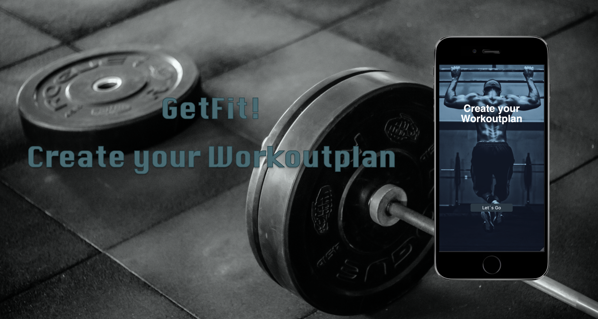
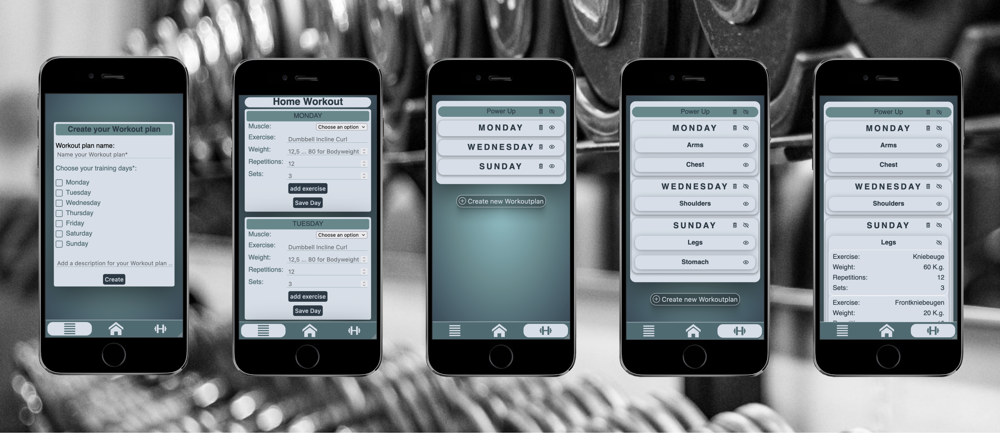
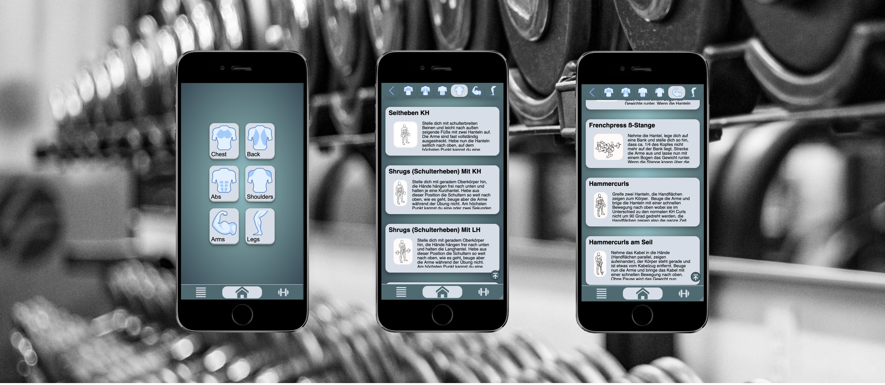

# Capstone Project: GetFit!



Create your own workout plans whether for home training or training in the gym, with GetFit!



With GetFit! you always have your workout plans with you, no matter if you work out in the gym or at home, create your individual workout plan for every situation.



For newcomers GetFit! also offers a collection of exercises sorted by the 6 main muscle groups of the human body.

## Demo:

You can find the hosted version on Vercel: [Demo Version of Capstone Project](https://capstone-project-lake.vercel.app/)

**Important:** This demo is optimized for mobile screen.

## Tech Stack

- React 19
- React Router 7
- styled-components 6
- Vite 8
- Vitest 5 and React Testing Library
- ESLint
- Storybook 10
- JavaScript
- Own exercise library (97 exercises, German and English)
- localStorage
- npm
- Vercel

## Project Setup

- Requires Node.js 22.12 or newer
- Clone this repository
- You don't need an API key
- Install all dependencies with `$ npm install`
- Run app in dev mode with `$ npm run dev` (or `$ npm start`)
- Server: [http://localhost:3000/](http://localhost:3000/)
- Run tests via `$ npm test` (watch mode: `$ npm run test:watch`)
- Check the code with `$ npm run lint`
- Build for production with `$ npm run build` (output in `build/`)
- Run Storybook with `$ npm run storybook`

## Languages

The app is available in English and German. Exercise names and descriptions come from the app's own exercise library in `src/data/` and exist in both languages. UI texts live in `src/i18n/translations.js`.

## Project Structure

```
src/
  assets/       images used by the app
  components/
    exercises/    exercise cards and muscle group navigation
    layout/       page layout and back-to-top button
    navigation/   bottom navigation and language switch
    planForm/     forms to create and edit workout plans
    ui/           small reusable building blocks (buttons, headers, …)
    workoutPlans/ display of saved workout plans
  data/         own exercise library: exercises, muscles, equipment, muscle groups
  hooks/        useWorkoutPlans (localStorage)
  i18n/         translations and language context
  pages/        one component per route
  styles/       design tokens (colors, fonts, radii) and global styles
  utils/        pure functions for workout plan data
  routes.js     all paths of the app
docs/images/    screenshots for this README
design-handoff/ handoff package for the UI/UX design
```
